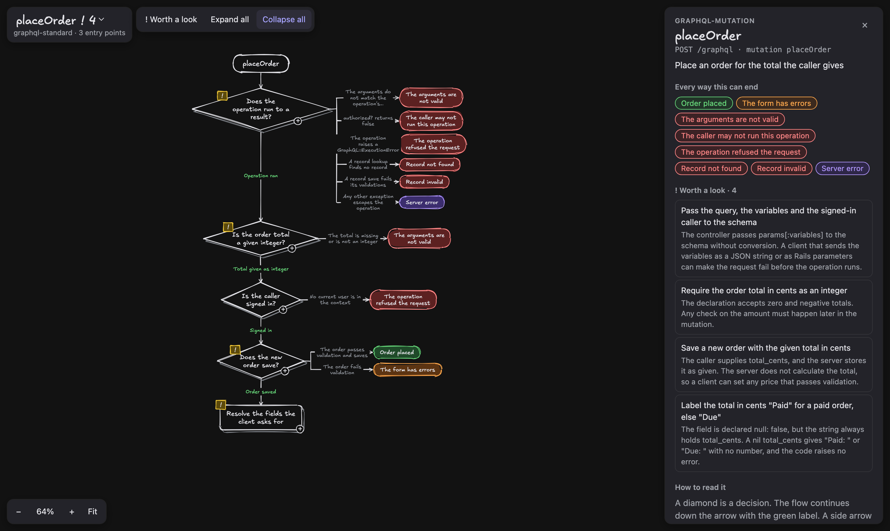

# logicmap

Review the decisions code makes instead of reading the code. A codebase becomes a
**decision graph**: entry points at the top, decisions as diamonds with both ways
out labeled, outcomes at the ends, every node traced to its source lines, drawn as
an Excalidraw-style diagram you expand step by step.



The `placeOrder` mutation of the test shop in `tests/fixtures/graphql-standard`. Each
diamond is a decision. Each colored box at the side is a way the request can end. The
panel lists every ending and the notes that a reviewer should read.

It runs on any PR, commit or feature of a Ruby codebase (Rails with graphql-ruby,
plain Rails, or plain Ruby). It also runs on TypeScript and JavaScript codebases
(Express, or plain modules). Each language is a pack in `extractor/languages/`, and `CONTRIBUTING.md`
shows how to add one. It also grows: every case it can't handle yet fails loudly,
is recorded in `gaps/`, and is closed with a test (see `CONTRIBUTING.md`).

```
skills/logicmap/         the agent skill: plan, extract, show, report, evolve
extractor/               reads a codebase, writes a decision graph
extractor/languages/     one pack per language: its parser, call lookup and framework adapters
viewer/                  the diagram
lib/                     what a valid graph is, and how its exits roll up (shared by extractor and viewer)
gaps/                    every case found unsupported, one file each, and how it was closed
tests/, evals/           the deterministic layers, and Claude's answers on fixture units
examples/                a sample .logicmap.json
docs/                    the screenshot above
vendor/writing-for-agents/  the rules every agent-facing text here follows
skills/logicmap/vendor/  asd-ste100 and humanizer: the rules every reader text follows
```

## Install

Needs Node 22+, Python 3 and a signed-in Claude Code CLI. Each language needs its parser:

- Ruby: a Ruby with the prism parser (Ruby 3.3+ ships it; on Ruby 2.7+ run
  `gem install prism`).
- TypeScript and JavaScript: run `npm install` once in the logicmap folder. It installs
  the TypeScript compiler, which parses both languages.

The index only parses files, so it does not need the target codebase's own runtime,
gems or node_modules.

As a Claude Code plugin:

```bash
claude plugin marketplace add https://github.com/HeshamaMohamed/logicmap.git
claude plugin install logicmap@logicmap
```

Or clone the repo and link the skill alone into `~/.claude/skills/`. It finds the
framework through the link:

```bash
git clone https://github.com/HeshamaMohamed/logicmap.git
ln -s "$PWD/logicmap/skills/logicmap" ~/.claude/skills/logicmap
```

Then ask Claude to review a PR's decisions, or to explain how a feature decides.

## Use it

```bash
bin/logicmap --repo PATH --list
bin/logicmap --repo PATH --base main --head my-branch --plan
bin/logicmap --repo PATH --base main --head my-branch
bin/logicmap --repo PATH --change SHA
bin/logicmap --repo PATH --entries placeOrder,Billing::Invoice#settle
bin/logicmap view
```

A PR or commit run extracts the head's code (read with `git archive`, the repo is
untouched) for every entry point the change reaches, marks the decisions it touched,
and lists the changed lines the graph leaves out. `--plan` shows the entry points and
costs nothing. Any method works as an entry point (`Class#method`, `Class.method`).
Each new method costs one Claude call, about $0.05; answers are cached by prompt, so a
rerun only pays for what changed. A failure prints `error[CODE]` with a remedy and
writes nothing.

Everything the framework writes goes to its cache folder: `$LOGICMAP_CACHE`, else
`$XDG_CACHE_HOME/logicmap`, else `~/.cache/logicmap`. There are the cached
answers, `graphs/<name>.json`, and `last-run.json` (the status, the plan and the
coverage of the last run). `bin/logicmap view` serves the viewer for those graphs
on http://localhost:8765/viewer/?graph=NAME (the run prints the URL). Add
`&focus=<node id>` after `#ep=<entry point>` to open straight to one decision. The
viewer loads rough.js and Excalifont from cdn.jsdelivr.net.

## A codebase's own conventions: `.logicmap.json`

The framework reads what many codebases of a language share. What only one codebase does goes
in `.logicmap.json` at its root (or `--config FILE`). Every key is optional; an
unknown key is refused.

| Key | Meaning |
|---|---|
| `sourcePaths` | paths the index reads. Ruby default: `app`, `lib`, `config/routes.rb`, `config/initializers`. TypeScript default: `.`, the whole repo except `node_modules`, build output and tests |
| `context` | lines about the codebase's own conventions, added to every prompt (its result helpers, for example) |
| `skipCalls` | regular expressions: a method id that matches is never offered for opening (logging, analytics) |
| `guardDsl` | Ruby only: class-level methods whose symbol argument names a guard of a GraphQL operation (default `guard`) |
| `entryPoints` | method id patterns, `*` as a wildcard, that are the entry points when no framework adapter applies (plain Ruby, plain TypeScript) |
| `fieldDepth`, `maxEntries`, `model`, `effort` | defaults for the flags of the same name |

`examples/rails-graphql.logicmap.json` is a sample for a codebase with its own result
helpers and guard DSL.

## How it works

1. **Language** (`extractor/languages/`). The first pack that recognises the codebase
   reads it. A project file at the root (a Gemfile, a gemspec, a package.json, a
   tsconfig.json) counts before source files below it. A codebase that no pack
   recognises stops with `UNSUPPORTED_LANGUAGE`.
2. **Index**. For Ruby, Prism parses the source paths (`extractor/languages/ruby/index.rb`):
   classes, modules, includes, methods with their lines, calls, visibility and rescues,
   class-body declarations, constants, routes and rake tasks. For TypeScript and
   JavaScript, the TypeScript compiler parses them (`extractor/languages/typescript/index.mjs`):
   functions, class methods and inline handlers, try/catch ranges, module constants and
   top-level registration calls. Its type checker resolves each call through imports and
   path aliases, so the call graph does not guess by name.
3. **Entry points** (`extractor/languages/<language>/adapters/`), first adapter that
   recognises the codebase. Ruby:
   - `rails-graphql`: a GraphQL::Schema class. Every mutation and resolver class and
     every inline field of a root type: middleware, the routed action that runs the
     schema, the arguments, `ready?`/`authorized?` and the codebase's guard DSL,
     `resolve`, then the fields of the type it returns. `rescue_from` (or a
     codebase's own exception table) maps exceptions to outcomes. It includes
     everything `rails` finds.
   - `rails`: every routed controller action (its filters, then the action), every
     Action Cable channel method, every job and every rake task; Rack middleware from
     config/initializers runs first for HTTP requests.
   - `ruby`: every public method, or the ones `entryPoints` names.

   TypeScript and JavaScript:
   - `express`: every route of an Express app and the routers it mounts: the middleware
     registered before it, in order, then its handlers. Library middleware (`cors()`)
     is drawn by name.
   - `plain`: every exported function and public method of an exported class, or the
     ones `entryPoints` names.
4. **Affected** (`extractor/affected.mjs`). For a change, a static call graph finds
   the entry points that reach the changed methods and declarations, nearest first.
5. **Units** (`extractor/extract.mjs`). One Claude call per method, or per class-body
   declaration group, with the numbered source, the methods it may open and the
   outcome codes. Each answer is checked, including every text a reader sees
   (against the vendored STE linter and the humanizer patterns), and sent back with
   the reasons when it fails, up to 3 attempts. The methods it opens become units of
   their own, so shared code is extracted once.
6. **Assemble** (`extractor/assemble.mjs`). Units become nodes; hand-off wrappers fold
   into what they hand off to; recursion is cut and named; the graph must pass
   `lib/validate.mjs`.
7. **Change** (`extractor/change.mjs`). The diff marks the most specific nodes it
   touches, directly or through a constant or a method the graph does not open;
   everything else it touches becomes the graph's `coverage`, with a reason.

## Format: `decision-graph/0.1`

```jsonc
{
  "format": "decision-graph/0.1",
  "codebase": { "name": "...", "path": "...", "commit": "...", "language": "ruby|typescript" },
  "change":   { "commit": "<sha or base..head>", "title": "..." },   // optional
  "coverage": { "uncovered": [{ "where": "path:lines", "reason": "..." }] },  // optional
  "outcomes": { "<CODE>": { "kind": "success|user-error|rejected|crash", "text": "..." } },
  "entryPoints": [
    { "id": "...", "kind": "graphql-mutation|graphql-query|http|channel|job|rake",
      "name": "...", "trigger": "...", "summary": "...", "steps": ["<node id>", ...] }
  ],
  "nodes": {
    "<node id>": {
      "text": "the step or decision in plain language",
      "question": "optional: the decision as a question, e.g. \"Signed in?\"",
      "pass": "optional: the answer that lets the flow carry on, e.g. \"Signed in\"",
      "detail": "optional: one or two more sentences",
      "source": ["path/to/file.rb:10-20"],
      "steps": ["<node id>", ...],                                   // inside, in order
      "branches": [{ "when": "...", "steps": ["<node id>", ...] }],   // a fork
      "exits": [{ "when": "...", "outcome": "<CODE>", "raises": "Exception::Class" }],  // the request ends here
      "catches": ["Exception::Class"],                               // rescued here: inside exits stop at this step ("*": any error)
      "returns": [{ "when": "...", "value": "Deny" }],               // a helper's answer to its caller
      "change": "added|modified|removed",
      "notes": ["a decision worth a reviewer's look"]
    }
  }
}
```

Rules:

- **Leaves are text, never code.** `source` keeps every node traceable to its lines.
- **Every decision shows both ways out.** A node with a `question` is a diamond:
  `exits` leave to the side with their conditions, the flow carries on downward
  labeled with `pass`, `returns` end only the helper (drawn gray), and `branches`
  fork into labeled columns that rejoin.
- **A collapsed node shows every exit of everything inside it.** Expanding a node
  never adds or removes a way out of it; it only shows which step takes it.
- **A node can be shared.** One id referenced from several parents is one decision.
- **A caught exception ends nothing past the step that catches it.** An exit whose
  `raises` a step `catches` still shows inside the callee, and drops out of every
  rollup above that step.
- **The change is shown in context**, and the lines it changes outside the graph are
  listed in `coverage`.
- **An unknown reference is an error.** `lib/validate.mjs` refuses the whole graph.


## License

MIT, in `LICENSE`. Each vendored skill keeps its own MIT license in its folder.
